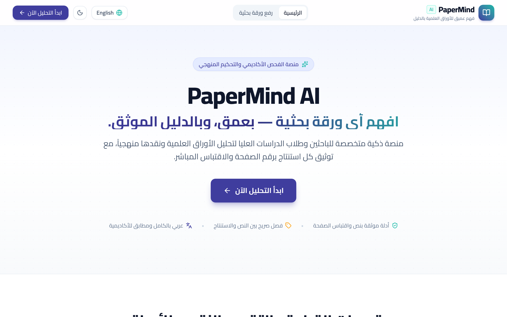
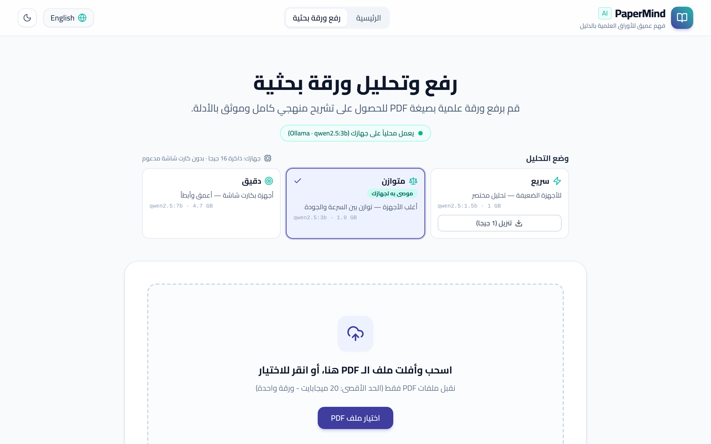
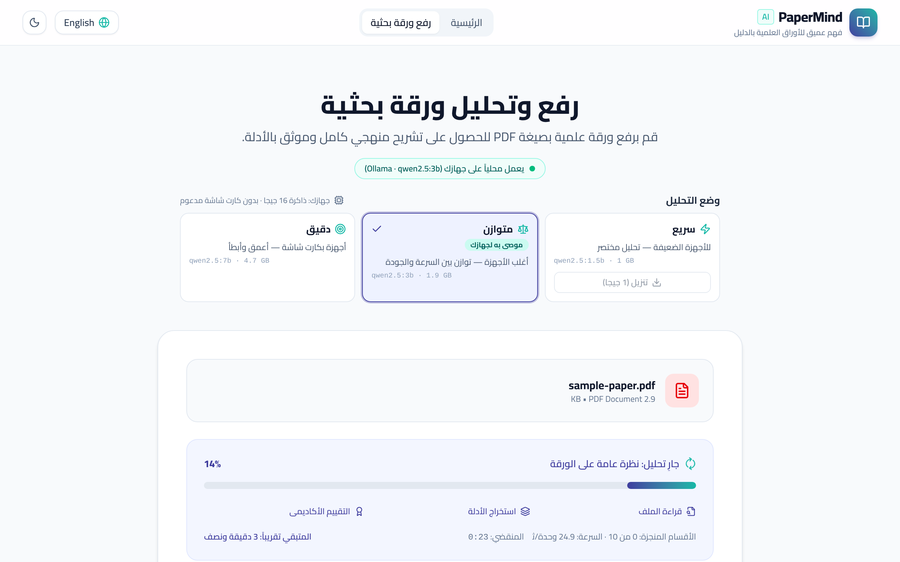
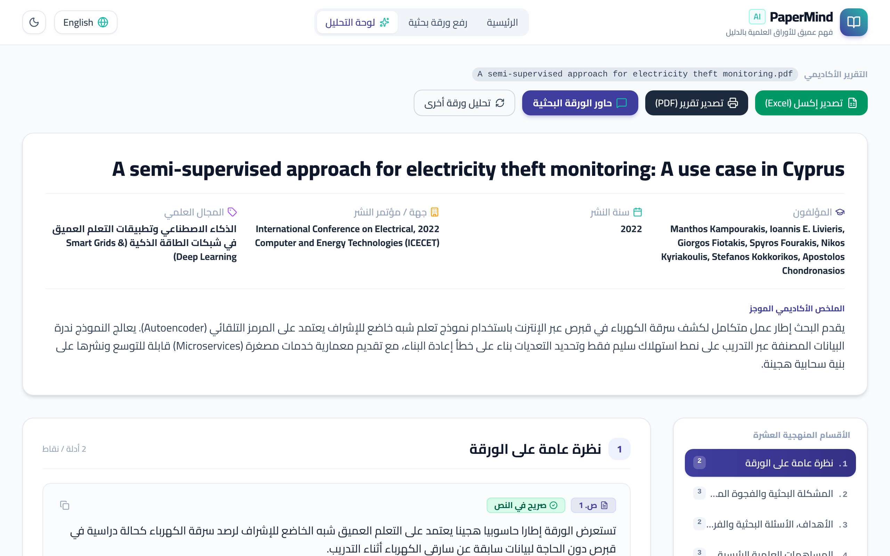
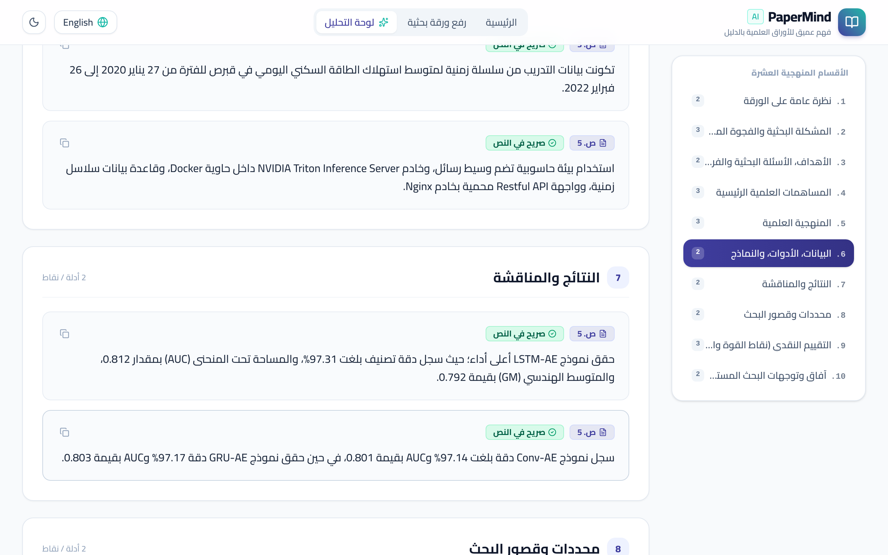
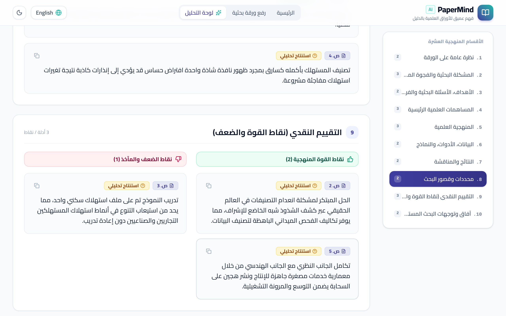
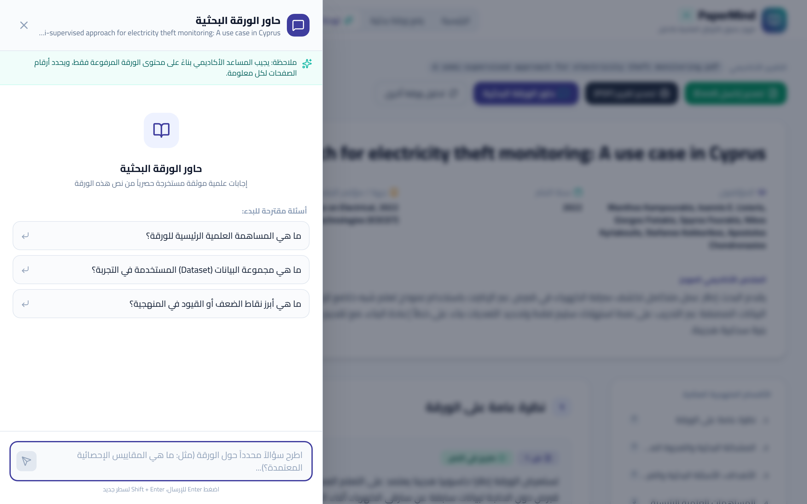
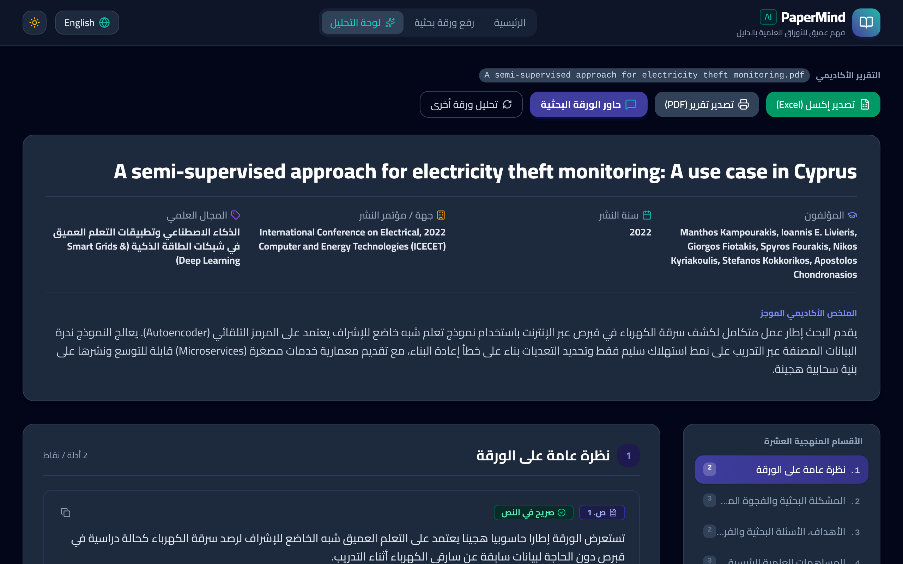

<div dir="rtl" align="right">

<p align="center">
  
</p>

<h1 align="center">PaperMind AI</h1>

<p align="center"><b>افهم أي ورقة بحثية — بعمق، وبالدليل الموثّق</b></p>

<p align="center">
  <a href="https://github.com/MohamedEzaldine/papermind-ai/releases/latest"></a>
  <a href="https://github.com/MohamedEzaldine/papermind-ai/releases/latest"></a>
  <a href="https://github.com/MohamedEzaldine/papermind-ai/releases/latest"></a>
  <a href="#"></a>
  <br>
  <a href="https://aistudio.google.com"></a>
  <a href="https://ai.google.dev"></a>
  <a href="https://ollama.com"></a>
  <a href="https://ollama.com/library/qwen2.5"></a>
  <a href="https://www.anthropic.com/claude-code"></a>
  <br>
  <a href="https://react.dev"></a>
  <a href="https://www.typescriptlang.org"></a>
  <a href="https://nodejs.org"></a>
  <a href="https://www.electronjs.org"></a>
  <a href="https://tailwindcss.com"></a>
  <a href="https://vite.dev"></a>
  <a href="https://expressjs.com"></a>
  <br>
  <a href="#"></a>
  <a href="#"></a>
  <a href="#"></a>
</p>

---

## 📖 نبذة عن البرنامج

**PaperMind AI** برنامج يحلّل الأوراق البحثية في أي تخصص علمي. ترفع ملف PDF واحد، فيقدّم لك تقييماً منهجياً في **10 أقسام**، على طريقة المحكّمين الأكاديميين. كل نقطة في التحليل مرتبطة **برقم الصفحة** و**اقتباس من الورقة نفسها**، ويتحقق البرنامج تلقائياً من أن الاقتباس موجود فعلاً في نص الورقة.

**يعمل البرنامج على جهازك بالكامل:** لا يحتاج إلى مفاتيح API، ولا إلى إنترنت بعد التثبيت، ولا تغادر الورقة جهازك.

---

## ⬇️ التنزيل

<p align="center">
  <a href="https://github.com/MohamedEzaldine/papermind-ai/releases/latest">
    
  </a>
</p>

1. افتح صفحة **[آخر إصدار](https://github.com/MohamedEzaldine/papermind-ai/releases/latest)**.
2. من قسم **Assets** نزّل الملف `PaperMind-AI-Setup-1.0.0.exe`.

---

## 🖼️ لقطات من البرنامج

| الصفحة الرئيسية | رفع الورقة واختيار وضع التحليل |
|:---:|:---:|
|  |  |
| **التقدم أثناء التحليل** | **لوحة التحليل** |
|  |  |
| **النتائج مع رقم الصفحة ونوع الدليل** | **التقييم النقدي: القوة والضعف** |
|  |  |
| **حاور الورقة البحثية** | **الوضع الليلي** |
|  |  |

> لوحة التحليل في اللقطات تعرض تحليلاً لورقة *A semi-supervised approach for electricity theft monitoring: A use case in Cyprus* (ICECET 2022).

---

## ✨ المميزات

- **تحليل منهجي في 10 أقسام:**
  1. نظرة عامة
  2. المشكلة البحثية والفجوة المعرفية
  3. الأهداف والأسئلة البحثية والفرضيات
  4. المساهمات العلمية
  5. المنهجية
  6. البيانات والأدوات والنماذج
  7. النتائج والمناقشة
  8. القيود
  9. التقييم النقدي (نقاط القوة والضعف)
  10. آفاق البحث المستقبلي
- **كل نقطة موثّقة:** معها رقم الصفحة، وعلامة تبيّن هل المعلومة **صريحة في النص** أم **استنتاج تحليلي**، واقتباس من الورقة.
- **التحقق التلقائي من الأدلة:** يقارن البرنامج كل اقتباس بنص الورقة الحقيقي ويصحّح رقم الصفحة إن لزم. وينبّه أيضاً إلى أي رقم غير موجود في الورقة.
- **حاور الورقة البحثية:** اسأل أي سؤال عن الورقة، فتأتيك الإجابة من الورقة فقط مع أرقام الصفحات. وإذا لم تكن المعلومة في الورقة، يخبرك البرنامج بذلك.
- **ثلاثة أوضاع للتحليل** (سريع / متوازن / دقيق)، مع توصية تلقائية بالوضع المناسب لقدرة جهازك.
- **نسبة إنجاز حقيقية** أثناء التحليل، مع اسم القسم الجاري تحليله والوقت المتبقي.
- **تصدير التحليل** إلى ملف Excel أو تقرير PDF جاهز للطباعة.
- **واجهة عربية وإنجليزية** مع دعم كامل للكتابة من اليمين لليسار، ووضع ليلي.
- **خصوصية كاملة:** التحليل يتم على جهازك، والورقة لا تُرفع إلى أي خادم.

---

## 🛠️ التثبيت

1. شغّل ملف `PaperMind-AI-Setup-1.0.0.exe`.
2. إذا ظهرت رسالة **«Windows protected your PC»**، اضغط **More info** ثم **Run anyway**. تظهر هذه الرسالة لأن البرنامج غير موقّع بشهادة تجارية مدفوعة.
3. اختر مكان التثبيت واضغط **Install**.
4. يكمل برنامج التثبيت الباقي تلقائياً، وتظهر نسبة التقدم داخل نافذته:
   - يثبّت محرك الذكاء الاصطناعي المحلي **Ollama** إن لم يكن موجوداً.
   - يفحص ذاكرة الجهاز وكارت الشاشة، ثم ينزّل نموذج الذكاء الاصطناعي المناسب (من 1 إلى 4.7 جيجابايت).
5. افتح **PaperMind AI** من الاختصار على سطح المكتب.

> التثبيت يحتاج إلى إنترنت مرة واحدة فقط لتنزيل النموذج. بعد ذلك يعمل البرنامج بدون إنترنت.

---

## 🚀 طريقة الاستخدام

1. **افتح البرنامج** واضغط **«ابدأ التحليل الآن»**.
2. **اختر وضع التحليل.** الوضع المناسب لجهازك عليه علامة «موصى به لجهازك». ولاستخدام وضع آخر غير مثبّت، اضغط **«تنزيل»** بجانبه.
3. **ارفع الورقة:** اسحب ملف PDF إلى المربع أو اضغط **«اختيار ملف PDF»**. يقبل البرنامج ملفاً واحداً بحجم أقصى 20 ميجابايت، ويجب أن يكون الملف نصياً لا صوراً ممسوحة ضوئياً.
4. **اضغط «تحليل الورقة».** ستظهر نسبة الإنجاز، واسم القسم الجاري تحليله، والوقت المتبقي.
5. **استعرض لوحة التحليل:**
   - تنقّل بين الأقسام العشرة من القائمة الجانبية.
   - اضغط **«عرض الاقتباس المباشر»** لترى نص الورقة الداعم لأي نقطة.
   - راجع النقاط التي عليها علامة **«تحقق يدوياً»** في الورقة بنفسك.
6. **اسأل الورقة:** اضغط **«حاور الورقة البحثية»** واكتب سؤالك، أو اختر سؤالاً من الأسئلة المقترحة.
7. **صدّر النتائج:** اضغط **«تصدير إكسل»** أو **«تصدير تقرير (PDF)»**.

---

## ⚙️ أوضاع التحليل

| الوضع | النموذج | الحجم | يُختار تلقائياً عندما | ملاحظات |
|:---:|:---:|:---:|:---|:---|
| ⚡ **سريع** | `qwen2.5:1.5b` | 1 GB | ذاكرة الجهاز أقل من 8 جيجا | للأجهزة الضعيفة، وتحليله مختصر |
| ⚖️ **متوازن** | `qwen2.5:3b` | 1.9 GB | ذاكرة 8 جيجا أو أكثر بدون كارت شاشة مناسب | مناسب لأغلب الأجهزة |
| 🎯 **دقيق** | `qwen2.5:7b` | 4.7 GB | كارت شاشة NVIDIA بذاكرة 6 جيجا أو أكثر، وذاكرة 12 جيجا أو أكثر | أعمق، لكنه بطيء جداً بدون كارت شاشة |

يمكنك تغيير الوضع في أي وقت من صفحة رفع الورقة.

---

## 💻 متطلبات التشغيل

| | الحد الأدنى | المستحسن |
|---|---|---|
| **نظام التشغيل** | Windows 10 / 11 (64-bit) | Windows 11 |
| **الذاكرة (RAM)** | 4 جيجابايت | 16 جيجابايت |
| **مساحة القرص** | 3 جيجابايت | 8 جيجابايت |
| **كارت الشاشة** | غير مطلوب | NVIDIA بذاكرة 6 جيجابايت أو أكثر (تحليل أسرع بكثير) |
| **الإنترنت** | مرة واحدة عند التثبيت | — |

---

## 🧠 كيف يعمل البرنامج

```
ملف PDF
  │
  ├─ 1. استخراج نص كل صفحة، وحذف قائمة المراجع
  ├─ 2. اختيار أهم الجمل المتعلقة بكل قسم من الأقسام العشرة
  ├─ 3. النموذج المحلي (Ollama) يكتب النقاط، ويشير إلى رقم الجملة الداعمة
  ├─ 4. الاقتباس ورقم الصفحة يُؤخذان من الورقة نفسها، لا من النموذج
  ├─ 5. حذف النقاط المكررة والأرقام غير الموجودة في الجملة المستشهد بها
  ├─ 6. الترجمة إلى العربية مع فحص جودتها
  └─ 7. التحقق من الأدلة، ثم عرض لوحة التحليل
```

---

## 🧰 التقنيات المستخدمة في الكود

| المجال | التقنية |
|---|---|
| واجهة المستخدم | React 19 · TypeScript · Tailwind CSS 4 · Vite · Lucide Icons · Motion |
| الخادم | Node.js 22 · Express · unpdf (استخراج نص PDF) |
| الذكاء الاصطناعي المحلي | Ollama · Qwen 2.5 (1.5B / 3B / 7B) |
| الذكاء الاصطناعي السحابي (نسخة الويب) | Google Gemini API (`@google/genai`) |
| برنامج سطح المكتب | Electron 33 · electron-builder (NSIS) |
| التصدير | SheetJS (Excel) · طباعة المتصفح (PDF) |
| البناء والإصدار | GitHub Actions (بناء ملف التثبيت تلقائياً على Windows) |

## 🧩 الأدوات المستخدمة في بناء التطبيق

| الأداة | الاستخدام |
|---|---|
| **Google AI Studio (Build)** | بناء النسخة الأولى من التطبيق انطلاقاً من وصف مفصّل |
| **Claude Code** | تطوير التطبيق بعد النسخة الأولى: التحقق من الأدلة، والتحليل المحلي، وبرنامج سطح المكتب، وبرنامج التثبيت |
| **Google Gemini** | محرك التحليل في نسخة الويب |
| **Ollama** | تشغيل نماذج الذكاء الاصطناعي محلياً على الجهاز |
| **GitHub · GitHub Actions** | إدارة الكود وبناء ملف التثبيت ونشر الإصدارات |

---

## 🎓 مشروع التخرج

هذا التطبيق هو مشروع التخرج لـ **برنامج سفراء الذكاء الاصطناعي** (AI Ambassadors Program):

- **الجهة المنفّذة:** المعهد القومي للاتصالات (NTI)
- **تحت مظلة:** وزارة الاتصالات وتكنولوجيا المعلومات — جمهورية مصر العربية
- **مسار المشروع:** المشروع رقم 1، «تصميم وبناء تطبيق ذكي باستخدام أدوات الذكاء الاصطناعي الحديثة»

**إعداد:** Mohamed Ezaldine

---

## 👨‍💻 للمطورين: التشغيل من الكود

يحتاج التشغيل من الكود إلى Node.js 20 أو أحدث، و[Ollama](https://ollama.com) مع نموذج مثبّت (مثلاً `ollama pull qwen2.5:3b`).

```bash
npm install
npm run dev          # نسخة الويب على http://localhost:3000
npm run desktop      # برنامج سطح المكتب
npm test             # الاختبارات
npm run dist:win     # بناء ملف التثبيت (على Windows)
```

| المسار | المحتوى |
|---|---|
| `server.ts` | الخادم وواجهات `/api/analyze` و`/api/chat` و`/api/models` |
| `server/localAnalysis.ts` | التحليل المحلي قسماً قسماً |
| `server/retrieval.ts` | اختيار الجمل المتعلقة بكل قسم، وفحص النقاط والترجمة |
| `server/evidence.ts` | التحقق من الاقتباسات والأرقام مقابل نص الورقة |
| `server/hardware.ts` | فحص الجهاز واختيار وضع التحليل المناسب |
| `server/ollama.ts` | الاتصال بـ Ollama مع الحماية من التعليق |
| `electron/main.mjs` | برنامج سطح المكتب |
| `build/installer.nsh` · `build/pull-model.ps1` | خطوات برنامج التثبيت وتنزيل النموذج |
| `src/` | واجهة المستخدم |

---

## ⚠️ حدود معروفة

- التحليل المحلي بالنماذج الصغيرة (1.5B و3B) أبسط من تحليل النماذج السحابية الكبيرة. لذلك راجع النقاط المهمة في الورقة نفسها.
- النقاط التي تتعذّر ترجمتها بجودة كافية تظهر بالإنجليزية بدلاً من ترجمة خاطئة.
- الملفات الممسوحة ضوئياً (صور بدون نص) غير مدعومة حالياً.
- البرنامج أداة مساعدة للقراءة والفهم، ولا يغني عن قراءة الورقة.

---

## © الحقوق

جميع الحقوق محفوظة © 2026 Mohamed Ezaldine.

</div>

---

<details>
<summary><b>English summary</b></summary>

**PaperMind AI** analyzes one research paper (PDF) at a time, in any discipline. It produces a 10-section, peer-review-style analysis in which every point carries its page number, an explicit-or-inferred label, and a quote taken from the paper, and it automatically verifies that evidence against the PDF text.

- **Desktop app for Windows.** It runs fully offline with Ollama after installation, with no API keys. The installer sets up Ollama and downloads the model that suits the computer. [Download the latest release](https://github.com/MohamedEzaldine/papermind-ai/releases/latest).
- **Features.** Fast, Balanced and Accurate modes; live progress with an estimate of the time left; Ask the Paper (Q&A grounded in the paper); Excel and PDF export; Arabic and English interface with RTL support; dark mode.
- **Graduation project** of the AI Ambassadors Program, National Telecommunication Institute (NTI), Ministry of Communications and Information Technology, Egypt.

</details>
